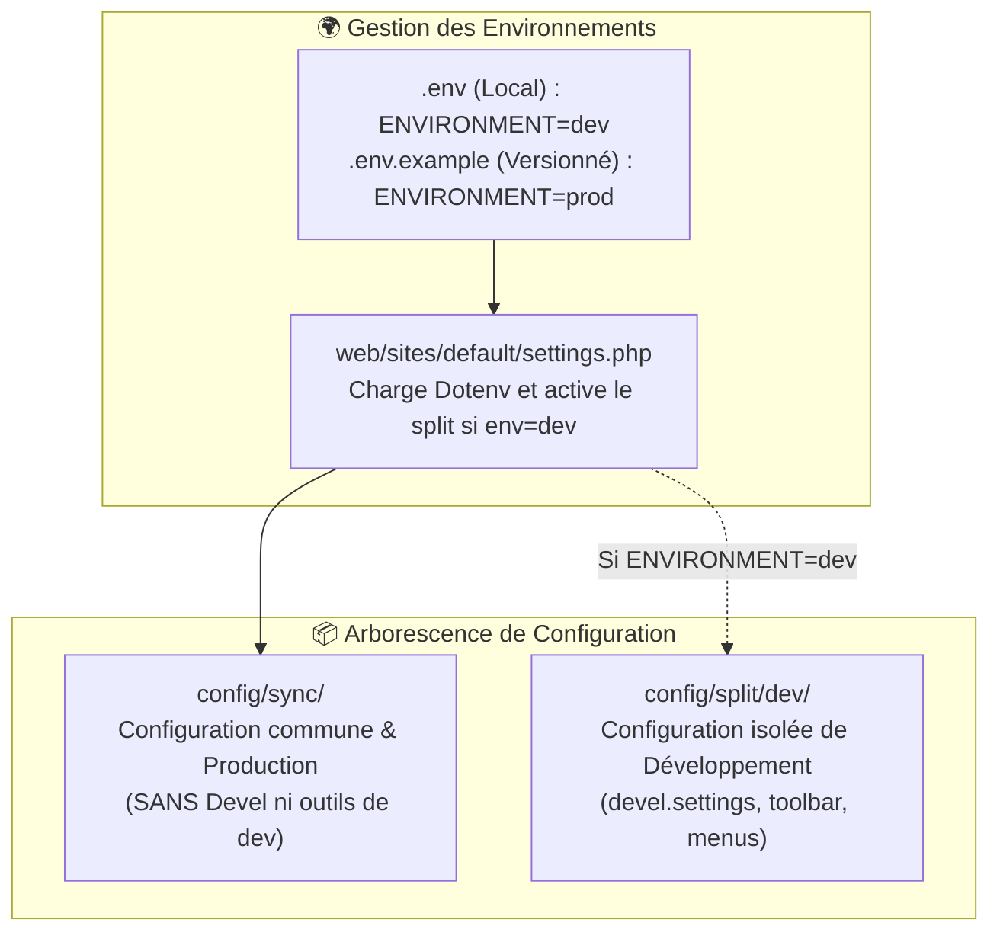

# Guide de Gestion des Configurations & Multi-Environnement — ANETI

Ce skill fournit les règles strictes pour synchroniser, exporter et isoler les configurations Drupal du portail ANETI sans jamais polluer les environnements de recette ou de production.

---

## 1. Architecture Multi-Environnement



---

## 2. Emplacements des Fichiers

| Rôle | Emplacement | Gestion Git |
| :--- | :--- | :---: |
| **Variables d'environnement réelles** | `.env` (racine) | **Ignoré** (`.gitignore`) |
| **Modèle d'environnement par défaut** | `.env.example` (racine) | **Versionné** (défini sur `prod`) |
| **Configurations de Production** | `config/sync/` | **Versionné** |
| **Configurations de Développement** | `config/split/dev/` | **Versionné** |
| **Définition du Split Dev** | `config/sync/config_split.config_split.dev.yml` | **Versionné** |

---

## 3. Règle d'Or : Jamais de Modules de Dev en Production

1. Les modules de développement (ex: `drupal/devel:^5.1`) sont positionnés exclusivement dans la section **`require-dev`** du `composer.json`.
2. Le fichier `config/sync/core.extension.yml` ne doit **JAMAIS** contenir `devel`.
3. Les configurations de `devel` doivent être contenues **uniquement** dans `config/split/dev/`.

---

## 4. Commandes Usuelles de Synchronisation

### Vérifier l'état et les deltas :
```bash
ddev drush cst
```

### Exporter la configuration :
```bash
ddev drush cex -y
```
*Note* : Grâce à Config Split, Drush dispatche automatiquement les configurations de `devel` dans `config/split/dev/` et le reste dans `config/sync/`.

### Importer la configuration :
```bash
ddev drush cim -y
```

### Vérifier le statut de l'environnement actif :
```bash
ddev drush ev "echo 'Environnement actif : ' . (getenv('ENVIRONMENT') ?: 'prod') . PHP_EOL;"
```

