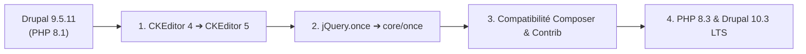

# Guide de Migration vers Drupal 10 — Portail ANETI

Ce skill guide l'agent et les développeurs dans les étapes techniques nécessaires pour faire passer le portail ANETI de **Drupal 9.5.11 (PHP 8.1)** à **Drupal 10.3 (PHP 8.3)**.

---

## 1. Les 4 Piliers Critiques de la Migration Drupal 10



---

## 2. Pilier 1 : Remplacement de `jQuery.once` par `core/once`

Dans Drupal 10, `jquery.once` est entièrement supprimé du core au profit de la bibliothèque vanilla JS `@drupal/once` (`core/once`).

### Emplacement des scripts JS à auditer :
- Thème actif : `web/themes/custom/job_board/assets/js/` et `web/themes/custom/job_board/dist/js/`
- Modules custom : `web/modules/custom/*/js/`

### Règle de transformation :
```javascript
// ❌ Ancien code Drupal 8/9 (Déprécié)
(function ($, Drupal) {
  Drupal.behaviors.myBehavior = {
    attach: function (context, settings) {
      $('.my-selector', context).once('my-behavior').each(function () {
        // Traitement
      });
    }
  };
})(jQuery, Drupal);

// ✅ Nouveau code Drupal 9/10 (Standard)
(function ($, Drupal, once) {
  Drupal.behaviors.myBehavior = {
    attach: function (context, settings) {
      const elements = once('my-behavior', '.my-selector', context);
      elements.forEach(function (element) {
        // Traitement (ou $(element) si jQuery nécessaire)
      });
    }
  };
})(jQuery, Drupal, once);
```

### Déclaration dans `libraries.yml` :
Remplacer `core/jquery.once` par `core/once` dans les dépendances.

---

## 3. Pilier 2 : Migration de CKEditor 4 vers CKEditor 5

CKEditor 4 n'est plus supporté sous Drupal 10. Le module core `ckeditor5` prend le relais.

### Procédure de bascule :
1. Vérifier les formats de texte configurés sous ANETI (`basic_html`, `full_html`, `restricted_html`) dans `config/sync/filter.format.*.yml`.
2. Activer le module core `ckeditor5` :
   ```bash
   ddev drush en ckeditor5 -y
   ```
3. Mettre à niveau les configurations d'éditeurs :
   - Basculer le plugin d'éditeur de `ckeditor` vers `ckeditor5`.
   - Supprimer le module legacy `ckeditor` :
   ```bash
   ddev drush pmu ckeditor -y
   ```
4. Exporter la configuration mise à jour :
   ```bash
   ddev drush cex -y
   ```

---

## 4. Pilier 3 : Matrice Composer pour Drupal 10

### Contraintes clés dans `composer.json` :
- `"drupal/core-composer-scaffold": "^10.3"`
- `"drupal/core-recommended": "^10.3"`
- `"drush/drush": "^12.0 || ^13.0"`

### Commandes de simulation de mise à jour :
```bash
# Vérifier la faisabilité sans casser l'installation actuelle
ddev composer outdated "drupal/*"

# Simuler l'installation de Drupal 10
ddev composer require "drupal/core-recommended:^10.3" --no-update --dry-run
```

---

## 5. Pilier 4 : Validation et Banc de Test

Après toute modification liée à Drupal 10, toujours exécuter :
```bash
# Vider les caches
ddev drush cr

# Lancer la suite complète de non-régression
ddev drush scr scripts/test_aneti_features.php
```
Le résultat doit afficher **19 / 19 PASS (0 échec)**.

