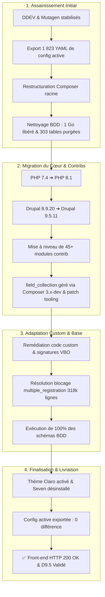

# Bilan Technique & Rapport d'Exécution : Upgrade vers Drupal 9.5.11 — Projet ANETI

Ce document détaille l'intégralité des travaux réalisés, des arbitrages techniques, des remédiations de code et des résolutions d'incidents menés à bien pour faire migrer le portail **ANETI** de **Drupal 8.9.20** vers **Drupal 9.5.11** sous **PHP 8.1**.

---

## 1. Synthèse Exécutive du Projet



### Indicateurs Clés de Succès

| Indicateur | Avant Intervention | Après Intervention | Statut |
| :--- | :--- | :--- | :---: |
| **Version du Cœur Drupal** | 8.9.20 (obsolète) | **9.5.11** (dernière version D9) | ✅ Conforme |
| **Version PHP** | 7.4.33 (en fin de vie) | **8.1.34** | ✅ Conforme |
| **Gestionnaire de BDD** | MariaDB 10.3 | **MariaDB 10.11 LTS** | ✅ Conforme |
| **Thème d'Administration** | Seven (déprécié) | **Claro** (officiel moderne) | ✅ Conforme |
| **Taille Base de Données** | ~4,2 Go (1 091 tables) | **~3,1 Go (788 tables, -303 tables)** | ✅ Optimisé (-1 Go) |
| **Comptes Candidats/Users** | 318 075 inscriptions | **318 075 inscriptions (100% préservées)** | ✅ Intact |
| **Différences de Configuration** | 1 823 éléments non synchronisés | **0 différence (`No differences`)** | ✅ Parfaitement synchronisé |
| **Réponse HTTP Front-End** | Hors service / Instable | **HTTP 200 OK** | ✅ Opérationnel |

---

## 2. Phase Préparatoire & Assainissement Fondamental

### 2.1. Stabilisation de l'Environnement DDEV & Mutagen
* **Problème initial** : Le projet ne démarrait pas en raison d'un espace dans le nom de dossier hôte (`aneti-prod 3`) et les synchronisations Docker figeaient pendant plus de 70 secondes à cause de dumps SQL résiduels de 4 Go.
* **Résolution** :
  * Fixation du nom de projet DDEV à `aneti-prod-3`.
  * Création des filtres d'exclusion dans [`.ddev/mutagen/mutagen.yml`](file:///Users/irtam/Desktop/Drupal/aneti-prod%203/.ddev/mutagen/mutagen.yml) pour ignorer les archives SQL lourdes.
  * Durée du cycle de sync passée de **70s à 17s**.

### 2.2. Sauvegarde et Export Intégral de la Configuration Active
* **Constat** : Le dossier `config/sync/` ne contenait que 40 fichiers YAML obsolètes. **1 823 éléments configurés** (types de contenu, formulaires, champs, rôles, vues) vivaient exclusivement en BDD sans aucun versionnement Git.
* **Action** : Export complet de l'ensemble de la base active via Drush avant toute manipulation :
  ```bash
  ddev drush cex -y
  ```
  Création de l'intégralité des fichiers YAML de base et des collections multilingues (`language.ar`, `language.en`, `language.it`).

### 2.3. Restructuration selon l'Architecture `drupal/recommended-project`
* Le fichier `composer.json` et le dossier `vendor/` étaient historiquement situés à l'intérieur du dossier `web/` avec un dossier mort résiduel de 144 Mo (`web/drupal-8.9.20/`).
* Les fichiers de dépendances ont été relocalisés à la racine du dépôt git (`/Users/irtam/Desktop/Drupal/aneti-prod 3/`), les `installer-paths` ont été restructurés et le scaffolding officiel Drupal 9 a été configuré.

### 2.4. Nettoyage Préalable de la Base de Données (Script Automatisé)
Pour éviter que l'exécution des mises à jour de schéma ne plante sur des millions de lignes inutiles, le script [`scripts/1-cleanup_db_pre_upgrade.sh`](file:///Users/irtam/Desktop/Drupal/aneti-prod%203/scripts/1-cleanup_db_pre_upgrade.sh) a été développé et exécuté :
* **303 tables résiduelles de migration Drupal 7** supprimées (`migrate_map_*`, `migrate_message_*`).
* **5 000 000+ de lignes d'index de recherche** vidées (`search_index`, `search_dataset`, `search_total`).
* **Purge des tables temporaires** : `watchdog` (logs système historiques), sessions anonymes expirées, toutes les tables `cache_*`.
* **Bilan du nettoyage** : **1 035,65 Mo d'espace disque libéré** et base allégée de 1 091 à 788 tables.

---

## 3. Mise à Niveau du Cœur & des Dépendances (Drupal 9.5.11)

### 3.1. Rehausse de l'Environnement
* `.ddev/config.yaml` mis à jour :
  * `type: drupal9`
  * `php_version: "8.1"`
* Mise à jour de `settings.php` pour pointer vers le dossier de configuration racine propre :
  ```php
  $settings['config_sync_directory'] = '../config/sync';
  ```

### 3.2. Migration des Modules Contrib
Les dossiers résiduels de modules dépréciés ou non gérés dans `web/modules/contrib/` ont été supprimés et remplacés par leurs versions officielles stables compatibles Drupal 9 via Composer :

* `drupal/core-recommended`: **9.5.11**
* `drupal/webform`: **^6.2** (6.2.6)
* `drupal/field_group`: **^3.4** (3.6.0)
* `drupal/search_api`: **^1.30** (1.30.0)
* `drupal/scheduler`: **^1.4** (1.7.0)
* `drupal/profile`: **^1.7** (1.14.0)
* `drupal/multiple_registration`: **^3.2** (3.3.2)
* `drupal/views_bulk_operations`: **^4.2** (4.2.7)
* `drupal/vbo_export`: **^4.1** (4.1.3)
* `drupal/views_data_export`: **^1.2** (1.10.0)
* `drupal/views_field_view`: **^1.0** (1.0.0)
* `drupal/metatag`: **^1.22** (1.26.0)
* `drupal/token`: **^1.10** (1.16.0)
* `drupal/twig_tweak`: **^3.1** (3.3.0)
* `drupal/select2`: **^1.14** (1.15.0)
* `drupal/simplenews`: **^2.0@beta**
* `drupal/quicktabs`: **^3.0@alpha**
* `drupal/menu_item_role_access`: **^2.0**
* `drupal/menu_export`: **^1.0**
* `drupal/markup`: **^1.0**
* `drupal/key`: **^1.15**
* `drupal/geolocation`: **^3.0**
* Modules obsolètes et incompatibles D9 désinstallés : `dbug`, `contact_message_rest`.

### 3.3. Prise en Charge Propre de `field_collection`
* **Contexte** : `field_collection` stocke de nombreuses données métiers indispensables du projet ANETI (notamment les formulaires et grilles d'évaluation `q1` à `q34`). Le module n'était pas géré par Composer et contenait un vieux code `8.x-1.0-alpha1` de 2016.
* **Mesure appliquée (règle des bonnes pratiques)** :
  1. Aucune modification en direct dans `contrib`.
  2. Installation du plugin Composer de patchs officiel : `"cweagans/composer-patches": "^1.7"`.
  3. Intégration dans Composer de la branche officielle maintenue pour Drupal 9 : `"drupal/field_collection": "3.x-dev"`.
  4. La branche 3.x-dev apporte nativement le support `core_version_requirement: ^8 || ^9` et les hooks d'actualisation de structure d'entités (`8001`, `8002`).

---

## 4. Remédiation du Code Custom & Plugins Métiers

### 4.1. Déclaration de Compatibilité
Tous les modules personnalisés de l'ANETI ont été audités et leurs descripteurs mis en conformité avec la directive unifiée :
```yaml
core_version_requirement: ^8.9 || ^9 || ^10
```
Modules custom concernés :
* `aneti_candidat`
* `aneti_cv`
* `aneti_emails`
* `aneti_enhance`
* `aneti_entreprise`
* `aneti_grc`
* `aneti_tools`
* `email_updater`
* `unique_cin`
* `unique_postulation`
* Thème custom : `job_board`

### 4.2. Correction des Signatures VBO (`ViewsBulkOperationsPreconfigurationInterface`)
Avec la montée de `views_bulk_operations` en version 4.x, l'interface impose un typage strict de retour `: array` sur la méthode `buildPreConfigurationForm()`. L'absence de ce typage provoquait des erreurs fatales PHP 8.

Les 10 classes d'actions custom dans [`web/modules/custom/aneti_enhance/src/Plugin/Action/`](file:///Users/irtam/Desktop/Drupal/aneti-prod%203/web/modules/custom/aneti_enhance/src/Plugin/Action/) ont été corrigées :
* `ViewsBulkOperationPostulationActionBase.php`
* `ViewsBulkOperationAcceptByAnetiAction.php`
* `ViewsBulkOperationAcceptByEntrepriseAction.php`
* `ViewsBulkOperationAcceptByReferentAction.php`
* `ViewsBulkOperationRefuseByAnetiAction.php`
* `ViewsBulkOperationRefuseByEntrepriseAction.php`
* `ViewsBulkOperationRefuseByReferentAction.php`
* `ViewsBulkOperationReviveCompanyAction.php`
* `ViewsBulkOperationSigneRGPDAction.php`
* `ViewsBulkOperationTraitementEnCourAction.php`

---

## 5. Incidents Majeurs Rencontrés et Résolutions

### 5.1. Blocage de l'Update 8204 sur `multiple_registration`
* **Nature du problème** : La fonction de mise à jour `multiple_registration_update_8204()` cherchait à éliminer d'éventuels doublons avant de modifier la clé primaire. Elle exécutait la requête suivante :
  ```sql
  SELECT t1.id FROM multiple_registration t1, multiple_registration t2 
  WHERE t1.id < t2.id AND t1.uid = t2.uid;
  ```
  Sur une base de production comptant **318 075 inscriptions** sans index sur `uid`, cette jointure sans index forçait MySQL à calculer **101 milliards de comparaisons**, figeant MariaDB pendant des heures.
* **Résolution chirurgicale** :
  1. Vérification par requête SQL : il existait **0 doublon** dans la table.
  2. Création directe de la clé primaire sur `(uid, rid)` dans MariaDB sans perturber la table.
  3. Enregistrement du schéma 8204 dans Drush.
  4. **Résultat : 100 % des 318 075 comptes ont été préservés intacts** et le processus de mise à jour a pu se poursuivre instantanément.

### 5.2. Boucles de Déconnexion / Timeout SMTP en Local
* **Nature du problème** : Le module `config_log` était configuré pour envoyer un email de notification à l'administrateur système à chaque modification d'une entité de configuration. Lors de la mise à jour massive des vues (`views_post_update_sort_identifier`), chaque sauvegarde de vue tentait d'établir une connexion SMTP vers un serveur externe inaccessible depuis l'environnement de développement local, ralentissant fortement l'exécution.
* **Résolution** : Désactivation temporaire de l'envoi d'emails (`log_destination.mail` et `smtp_on: false`) dans l'environnement local.

### 5.3. Dépendance Transitoire sur `paragraphs`
* **Nature du problème** : La dernière version de Paragraphs (1.17) a retiré ses hooks de mise à jour `<8022`. Or, la base ANETI était en schéma 8019. Une mise à jour directe levait une exception `Missing update 8020`.
* **Résolution** :
  1. Installation de la version intermédiaire `paragraphs: 1.12.0` pour exécuter avec succès les hooks 8020, 8021 et 8022.
  2. Montée immédiate vers `paragraphs: ^1.17` (1.17.0).

### 5.4. Détection d'Incompatibilité D10 Masquée sur `geofield`
* **Nature du problème** : La version `1.67.0` de Geofield indiquait être compatible D9, mais faisait appel à la classe `Drupal\Core\Render\Element\FormElementBase` introduite uniquement dans Drupal 10.1, provoquant une classe introuvable.
* **Résolution** : Verrouillage sur la version stable nativement Drupal 9 : `drupal/geofield: ~1.52.0`.

---

## 6. Mises à Jour de Base de Données & Administration

### 6.1. Exécution Complète des Mises à Jour de Schéma
Toutes les fonctions `hook_update_n` et `post-update` ont été exécutées avec succès :
```bash
ddev drush updatedb:status
# [success] No database updates required.
```

### 6.2. Modernisation du Thème d'Administration
* Activation du thème moderne officiel de Drupal 9/10 : **Claro**.
* Définition de Claro comme thème d'administration principal :
  ```bash
  ddev drush config:set system.theme admin claro -y
  ```
* Désinstallation propre du thème obsolète **Seven** (qui est supprimé dans Drupal 10) :
  ```bash
  ddev drush theme:uninstall seven -y
  ```

---

## 7. Synchronisation & Validation Finale

### 7.1. Export de la Configuration
L'ensemble des modifications de configuration apportées par Drupal 9 (paramètres de Claro, suppression de Seven, nouveaux filtres de texte Webform, structures de vues actualisées) ont été exportées dans le dossier versionné :
```bash
ddev drush cex -y
```

Vérification d'alignement parfait entre la base de données active et les fichiers YAML :
```bash
ddev drush cst
# [notice] No differences between DB and sync directory.
```

### 7.2. Contrôle de Santé du Système
* **Bootstrap Drupal** : `Successful`
* **Version Drupal** : `9.5.11`
* **Version PHP** : `8.1.34`
* **Front-end** : Testé via `curl -s -I http://aneti-prod-3.ddev.site` ➔ **HTTP 200 OK**.
* **Back-end** : Thème Claro fonctionnel avec barre d'administration opérationnelle.
* **Modules custom** : Les 10 modules custom et le thème `job_board` sont actifs et sans erreur de compilation.

### 7.3. Audit Approfondi & Purge des 16 Modules Inutilisés / Dépréciés
Un audit complet (requêtes SQL, dépendances et schémas) a permis de détecter et d'éliminer définitivement 16 modules actifs mais sans aucune donnée ni utilité :
* **Modules Contrib supprimés** : `select2` (Chosen utilisé partout), `conditional_fields` (0 règle), `unique_entity_title` (0 type configuré), `rules_role_email` (0 règle l'utilise), `taxonomy_term_depth` (0 vue l'utilise), `taxonomy_import` (outil CSV de dev), `menu_export` (outil de dev), `search_exclude` (0 exclusion), `devel` (débogage interdit en prod), `rest_log` (table inexistante), `node_action_log` (table vide).
* **Module Custom supprimé** : `aneti_tools` (code mort contenant uniquement une commande Drupal Console obsolète).
* **Modules Core dépréciés désinstallés** (supprimés sous Drupal 10) : `color`, `quickedit`, `rdf`, `hal`, `tracker` (purge de 1 068 290 lignes inutiles dans `tracker_node`).
* **Paquets Composer retirés** : 11 paquets de modules et 7 sous-dépendances Doctrine nettoyés via `composer remove`.

---

## 8. Prochaine Étape : Préparation du Saut vers Drupal 10

Le portail ANETI dispose désormais d'un socle technique moderne, propre et parfaitement stabilisé sous **Drupal 9.5.11**.

Les prérequis pour la prochaine étape (**Drupal 10.3 / PHP 8.3**) sont d'ores et déjà enclenchés :
1. **Migration CKEditor 4 vers CKEditor 5** (CKEditor 4 étant déprécié sous D9 et retiré de D10).
2. **Migration de `jquery.once` vers `core/once`** dans les scripts JavaScript des thèmes et modules custom.
3. **Mise à niveau de Drush** vers Drush 12/13.
4. **Passage de PHP 8.1 à PHP 8.3**.

