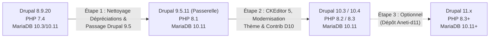

# Rapport d'Audit Technique & Plan de Migration : Portail ANETI
**Cible** : Drupal 8.9.20 $\rightarrow$ Drupal 9.5 (Passerelle) $\rightarrow$ Drupal 10.3/10.4 / Drupal 11  
**Auteur** : Expert / Architecte Drupal  
**Date d'audit** : Novembre 2026  

---

## 1. Audit Critique : Configuration Active (Base) vs Dossier `config/`

> [!CAUTION]
> **ANOMALIE MAJEURE & DANGER CRITIQUE DE PERTE DE DONNÉES DÉTECTÉS**  
> Les fichiers du dossier `config/sync/` **NE CORRESPONDENT PAS DU TOUT** à la configuration active de votre base de données.  
> **Taux de recouvrement : 0.0 %** (Aucune configuration fonctionnelle du site n'est présente dans `config/sync`).

### Chiffres Clés de la Comparaison
| Emplacement | Nombre d'éléments | Type de contenu |
| :--- | :--- | :--- |
| **Base de Données Active** (Table `config`) | **1 824 configurations** | Configuration complète du portail : types de contenu, vues, champs, workflows, rôles, formulaires, etc. |
| **Dossier `config/sync/` actuel** | **40 fichiers YAML** | Uniquement des fichiers de migration D7 $\rightarrow$ D8 (`migrate_plus.migration.aneti_upgrade_d7_*`). |
| **Dossier `config/sync/language/`** | **292 fichiers** | Traductions partielles (`ar`, `en`, `und`). |
| **Configurations Communes entre Base et `config/sync`** | **0 configuration** | **Rupture totale** : aucune configuration active n'a de fichier de base correspondant dans `config/sync`. |
| **Configurations actives manquantes dans `config/sync`** | **1 824 manquantes (100%)** | `core.extension`, `system.site`, `system.theme`, `node.type.*`, `views.view.*`, `workflows.*`, etc. |

### Diagnostic de la Cause
Lorsque le projet `aneti-prod 3` a été initialisé depuis le dépôt Git (`Aneti-d11.git`), seules les 40 définitions de migration et les fichiers de traduction ont été commités dans Git.  
Dans l'ancien dossier `aneti-prod 2/aneti-prod/config/sync`, **1 838 fichiers YAML** sont présents (dont 1 786 correspondent exactement à la base active). Les fichiers de configuration n'avaient tout simplement pas été commités ou exportés dans cette branche.

### Le Risque Immédiat
Si un développeur ou une chaîne d'intégration continue (CI/CD) exécute la commande standard :
```bash
drush config-import  # ou drush cim
```
Drupal considérera que les 1 824 configurations actives ont été volontairement supprimées dans `config/sync`. **Drupal supprimera alors instantanément tous les types de contenu, toutes les vues, les formulaires Webform, les rôles utilisateurs et les permissions.** Le site deviendra une coquille vide inaccessible.

### Action Corrective Immédiate
Il faut exporter la configuration active complète de la base de données vers `config/sync` :
```bash
ddev drush config:export -y  # ou ddev exec php ... pour générer les 1 824 fichiers YAML
```

---

## 2. Volumétrie & Base de Données (Échelle Nationale)

L'audit de la base de données confirme qu'ANETI est un portail de recrutement d'envergure nationale à très fort volume :

| Entité | Volume | Remarques d'Architecture |
| :--- | :--- | :--- |
| **Comptes Utilisateurs** (`users`) | **413 394 utilisateurs** | Candidats et entreprises. Gestion des sessions et des droits. |
| **Total Nœuds de Contenu** (`node`) | **1 068 074 nœuds** | Plus d'un million de contenus en production. |
| - *Postulations / Candidatures* (`postulation`) | **901 068 nœuds** | Volume massif de candidatures avec workflows de modération. |
| - *Curriculum Vitae* (`curriculum_vitae`) | **154 062 nœuds** | Fiches CV avec pièces jointes et export Europass. |
| - *Compléments de Postulation* | **9 298 nœuds** | Pièces complémentaires. |
| - *Offres d'Emploi* (`offre`) | **2 281 nœuds** | Offres actives et archivées. |
| **Révisions de Nœuds** (`node_revision`) | **1 308 631 révisions** | Historique lourd. Table `content_moderation_state_field_revision` > 250 Mo. |
| **Tables SQL** | **1 090 tables** | Forte charge relationnelle et tables de cache volumineuses (~500 Mo). |

> [!WARNING]
> **Impact sur la migration** : Lors de l'exécution des scripts de mise à jour de schéma (`drush updatedb`), les hooks de mise à jour d'entités qui parcourent les nœuds ou les révisions peuvent saturer la mémoire et le temps d'exécution. Les mises à jour doivent être exécutées **exclusivement en ligne de commande (CLI)** avec `memory_limit = 2048M` et par lots (`--batch=100`).

---

## 3. Stratégie & Trajectoire de Montée de Version

Drupal interdit formellement de sauter une version majeure (passer directement de D8 à D10 ou D11 est techniquement impossible via les scripts de migration de schéma).

### La Matrice des Versions Requises


- **Incompatibilité PHP croisée** :
  - Drupal 8.9 ne fonctionne pas sur PHP 8.1+ (erreurs fatales de typage et dépréciations Symfony).
  - Drupal 10 ne démarre pas sur PHP 7.4 (PHP 8.1 minimum requis, PHP 8.2/8.3 recommandé).
  - **Drupal 9.5.11 est la passerelle obligatoire** car il est compatible simultanément avec PHP 7.4 et PHP 8.1, permettant de faire la transition en douceur.

---

## 4. Audit du Code Personnalisé (13 Modules Custom - 4 638 Lignes)

Le volume de code sur mesure est raisonnable (4 638 lignes réparties sur 13 modules), mais contient des appels de fonctions procédurales dépréciées qui provoqueront des **erreurs fatales immédiates (White Screen of Death)** dès le passage à Drupal 9/10.

### Dépréciations Critiques et Corrections Obligatoires

| Module | Fichier / Ligne | Code Déprécié (D8) | Code Conforme (D9 / D10) | Criticité |
| :--- | :--- | :--- | :--- | :--- |
| **`aneti_enhance`** | Multiple (`.module:42, 162, 172...`) | `user_load($uid)` | `\Drupal\user\Entity\User::load($uid)` | **Bloquant Fatal D9** |
| **`aneti_enhance`** | Multiple (`.module:169, 191...`) | `node_load($nid)` | `\Drupal\node\Entity\Node::load($nid)` | **Bloquant Fatal D9** |
| **`aneti_enhance`** | `.module:562` | `node_load_multiple($nids)` | `\Drupal\node\Entity\Node::loadMultiple($nids)` | **Bloquant Fatal D9** |
| **`aneti_enhance`** | `.module:570` | `entity_load_multiple('user', $uids)` | `\Drupal::entityTypeManager()->getStorage('user')->loadMultiple($uids)` | **Bloquant Fatal D9** |
| **`aneti_cv`** | `EuropassController.php:58, 141` | `node_load($nid)`, `user_load($id)` | `Node::load($nid)`, `User::load($id)` | **Bloquant Fatal D9** |
| **`aneti_cv`** | `EuropassController.php:77` | `drupal_get_path('module', 'aneti_cv')` | `\Drupal::service('extension.list.module')->getPath('aneti_cv')` | **Bloquant Fatal D10** |
| **`aneti_tools`** | `CleanRevisionsCommand.php:75` | `\Drupal::entityManager()` | `\Drupal::entityTypeManager()` | **Bloquant Fatal D9** |
| **`aneti_enhance`** | `.module:46, 52, 533, 625` | `drupal_set_message(...)` | `\Drupal::messenger()->addMessage(...)` / `addError()` | **Bloquant Fatal D9** |
| **`aneti_candidat`**| `DefaultSubscriber.php:43` | `drupal_set_message(...)` | `\Drupal::messenger()->addStatus(...)` | **Bloquant Fatal D9** |
| **`aneti_migrate`** | `aneti_migrate.install:9` | `db_select('config', 'c')` | `\Drupal::database()->select('config', 'c')` | **Bloquant Fatal D9** |
| **10 modules** | `*.info.yml` | `core: 8.x` | `core_version_requirement: ^8.9 || ^9 || ^10` | **Bloquant D9** |

### Dépendance Composer Manquante (`aneti_cv`)
Le contrôleur Europass (`aneti_cv/src/AnetiTemplateProcessor.php`) utilise la bibliothèque `PhpOffice\PhpWord\TemplateProcessor`.  
Cette dépendance n'est pas installée dans Composer (`phpoffice/phpword`).  
$\rightarrow$ **Action** : Ajouter `composer require phpoffice/phpword` pour éviter un crash lors de la génération de CV Word/PDF.

---

## 5. Audit du Thème Personnalisé (`job_board`)

Le thème custom [`job_board`](file:///Users/irtam/Desktop/Drupal/aneti-prod%203/web/themes/job_board) comporte 4 incompatibilités majeures avec Drupal 10 :

1. **Suppression du thème de base `classy`** :
   Dans [`job_board.info.yml`](file:///Users/irtam/Desktop/Drupal/aneti-prod%203/web/themes/job_board/job_board.info.yml), la ligne `base theme: classy` fera planter Drupal 10 (`Theme classy not found`).  
   *Solution* : Installer le thème contrib `composer require drupal/classy` ou recopier les gabarits nécessaires et déclarer `base theme: stable9`.
2. **Suppression de `drupal_get_path()`** :
   Dans [`job_board.theme`](file:///Users/irtam/Desktop/Drupal/aneti-prod%203/web/themes/job_board/job_board.theme) (lignes 8 et 82), les appels procéduraux doivent être remplacés par `\Drupal::service('extension.list.theme')->getPath(...)` et `\Drupal::service('extension.list.module')->getPath(...)`.
3. **Suppression de `core/jquery.once`** :
   Dans [`job_board.libraries.yml`](file:///Users/irtam/Desktop/Drupal/aneti-prod%203/web/themes/job_board/job_board.libraries.yml) et [`skins_menu.js`](file:///Users/irtam/Desktop/Drupal/aneti-prod%203/web/themes/job_board/assets/includes/skins-menu/skins_menu.js), jQuery Once est supprimé au profit de la bibliothèque native Drupal `core/once`.
4. **Thème d'Administration `seven`** :
   Le thème admin actuel `seven` est supprimé dans Drupal 10. Il doit être basculé vers **Claro** :
   ```bash
   ddev drush config:set system.theme admin claro -y
   ```

---

## 6. Audit des Modules Contrib (88 Modules)

| Statut | Modules concernés | Recommandations de l'Expert |
| :--- | :--- | :--- |
| **Prêts D9 & D10 (Vert)** | `admin_toolbar`, `webform`, `paragraphs`, `metatag`, `pathauto`, `twig_tweak`, `views_bulk_operations`, `smtp`, `leaflet`, `select2`, `token` | Mettre à jour vers les versions stables récentes via Composer. |
| **Saut de Version Majeure (Orange)** | `simplenews` (8.x-1.x $\rightarrow$ 3.x/4.x)<br>`better_exposed_filters` (5.x $\rightarrow$ 6.x)<br>`jwt` (1.x $\rightarrow$ 2.x)<br>`we_megamenu` | Attention aux changements de configuration des filtres de vues et de structure de données. |
| **Modules Obsolètes à Désinstaller (Rouge)** | `field_collection` | Obsolète et abandonné (remplacé par `paragraphs`). À purger si plus aucun champ ne l'utilise. |
| | `file_entity` | Module de transition D7/D8 obsolète. Remplacé par `media` dans le cœur. |
| | `wbm2cm` | Transition Workbench Moderation achevée. Peut être désinstallé. |
| | `aneti_migrate`, `migrate_plus`, `migrate_tools`, `migrate_upgrade` | Modules de migration D7 $\rightarrow$ D8. Désinstaller une fois les imports historiques terminés. |
| | `rules` & `business_rules` | Rules est très instable/peu maintenu en D10. **Recommandation forte : migrer la logique métier vers le module moderne ECA (Event - Condition - Action)**. |

---

## 7. Feuille de Route d'Exécution Pas-à-Pas

### Phase 1 : Sécurisation & Préparation sur Drupal 8.9 (Immédiat)
1. **Sécuriser la configuration** : Exporter les 1 824 configurations actives vers `config/sync` pour combler le vide critique.
2. **Restructurer Composer** : Déplacer `composer.json` et `vendor/` de `web/` vers la racine du projet (`drupal/recommended-project`).
3. **Refactoriser le code custom** : Remplacer `node_load`, `user_load`, `drupal_set_message` et ajouter `core_version_requirement: ^8.9 || ^9 || ^10` sur tous les modules.
4. **Purger les caches et révisions obsolètes** pour alléger la base de 3.8 Go.

### Phase 2 : La Passerelle Drupal 9.5 (PHP 8.1)
1. Basculer l'environnement DDEV vers PHP 8.1 (`php_version: "8.1"`).
2. Mettre à jour le cœur vers `drupal/core-recommended:^9.5` et les modules contrib compatibles D9.
3. Exécuter les migrations de base : `ddev drush updatedb -y` et `ddev drush cr`.
4. Basculer le thème d'administration sur **Claro**.

### Phase 3 : Le Grand Saut vers Drupal 10.3/10.4 (PHP 8.3)
1. Adapter le thème `job_board` (`core/once`, suppression de la dépendance directe à `classy`, correction de `drupal_get_path`).
2. Migrer les formats de texte de CKEditor 4 vers **CKEditor 5** (inclus dans le cœur D10).
3. Basculer DDEV en PHP 8.3 (`php_version: "8.3"`).
4. Passer à `drupal/core-recommended:^10.3` et mettre à jour l'ensemble des modules contrib vers leurs versions D10.
5. Exécuter `ddev drush updatedb -y` et valider l'ensemble des parcours candidats/entreprises.
