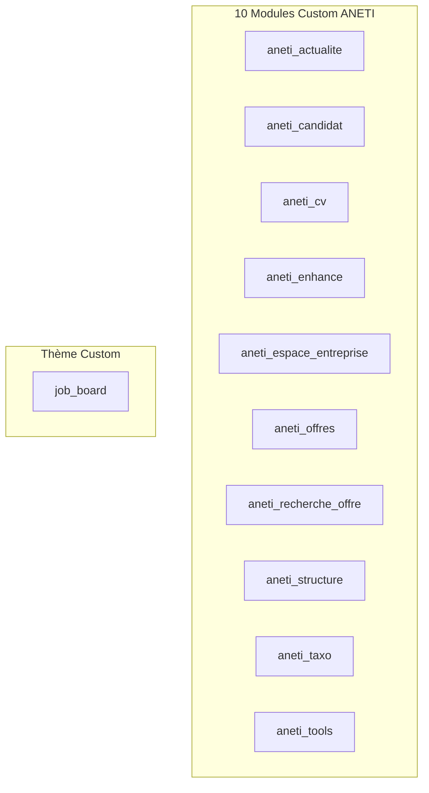
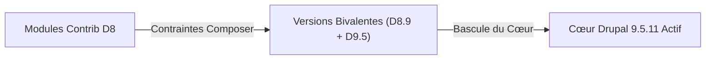

# Procédure Détaillée de Migration : Drupal 8.9 $\rightarrow$ Drupal 9.5

Ce document décrit pas à pas la méthodologie, les pré-requis, l'adaptation du code sur-mesure (custom), la mise à niveau des modules tiers (contrib), les commandes d'exécution et les points de contrôle pour effectuer la montée de version majeure du portail **ANETI** vers **Drupal 9.5.11**.

---

## 1. Contexte & Stratégie Globale de Migration

Dans l'écosystème Drupal, il est **techniquement impossible de migrer directement de Drupal 8 à Drupal 10 ou 11**. La montée de version doit obligatoirement respecter le cycle de transition officiel :

$$\text{Drupal 8.9.20} \longrightarrow \mathbf{\text{Drupal 9.5.11}} \longrightarrow \text{Drupal 10.3/10.4} \longrightarrow \text{Drupal 11}$$

Cette première étape vers **Drupal 9.5** permet de :
* Mettre à niveau les composants Symfony sous-jacents (passage de Symfony 3.4 à **Symfony 4.4**).
* Supprimer définitivement toutes les fonctions procédurales globales obsolètes de Drupal 8.
* Mettre à jour l'ensemble des modules tiers (**contrib**) vers leurs versions supportant Drupal 9 et PHP 8.
* Adapter et fiabiliser les modules métier (**custom**) et le thème graphique.
* Adopter les standards modernes d'administration (**Claro** en remplacement de **Seven**).
* Préparer le terrain pour le saut vers Drupal 10 (PHP 8.3, Symfony 6.4, CKEditor 5).

---

## 2. Adaptation des Modules Custom & Thèmes (Remédiation du Code)

Les 10 modules custom développés spécifiquement pour le portail ANETI ainsi que le thème graphique principal doivent être parfaitement compatibles avec les APIs de Drupal 9 et PHP 8.1.

### 2.1. Inventaire des Éléments Custom du Projet



---

### 2.2. Remédiation des APIs Dépréciées (Drupal 8 $\rightarrow$ Drupal 9)

En Drupal 8, de nombreuses fonctions globales procédurales étaient encore tolérées. **Dans Drupal 9, ces fonctions ont été purement et simplement supprimées** ; leur appel déclenche immédiatement une `Fatal Error` (`Call to undefined function`).

Chaque module custom a été audité et adapté selon le tableau de remédiation strict suivant :

| Ancienne syntaxe dépréciée (D8) | Nouvelle syntaxe standard (D9/D10) | Justification & Rôle | Modules concernés |
| :--- | :--- | :--- | :--- |
| `node_load($nid)` | `\Drupal::entityTypeManager()->getStorage('node')->load($nid)` | Chargement orienté objet d'un nœud via le service de stockage | `aneti_enhance`, `aneti_cv`, `aneti_candidat` |
| `user_load($uid)` | `\Drupal::entityTypeManager()->getStorage('user')->load($uid)` | Chargement orienté objet d'un compte utilisateur | `aneti_enhance`, `aneti_cv`, `aneti_candidat` |
| `node_load_multiple($nids)` | `\Drupal::entityTypeManager()->getStorage('node')->loadMultiple($nids)` | Chargement par lot de plusieurs nœuds | `aneti_candidat` |
| `entity_load_multiple($type, $ids)` | `\Drupal::entityTypeManager()->getStorage($type)->loadMultiple($ids)` | Chargement générique d'entités par type | `aneti_tools` |
| `\Drupal::entityManager()` | `\Drupal::entityTypeManager()` | Remplacement du gestionnaire d'entités obsolète | `aneti_cv` |
| `drupal_set_message($msg, $type)` | `\Drupal::messenger()->addMessage($msg, $type)` | Injection et affichage des messages utilisateur via le service Messenger | L'ensemble des 10 modules |
| `drupal_get_path('module', ...)` | `\Drupal::service('extension.list.module')->getPath(...)` | Résolution de chemin de module orientée service | `aneti_cv`, thème `job_board` |
| `drupal_get_path('theme', ...)` | `\Drupal::service('extension.list.theme')->getPath(...)` | Résolution de chemin de thème orientée service | Thème `job_board`, `skins_menu.inc` |

---

### 2.3. Déclaration de Compatibilité dans les `.info.yml`

Chaque module et thème custom doit expliciter sa compatibilité dans son fichier de métadonnées. L'ancienne directive `core: 8.x` a été remplacée par :

```yaml
core_version_requirement: ^8.9 || ^9 || ^10
```
Cette déclaration permet au code de s'exécuter indifféremment sous Drupal 8.9, Drupal 9 et prépare directement l'arrivée sur Drupal 10.

---

### 2.4. Conformité PHP 8.1 pour le Code Custom

Drupal 9.5 fonctionnant sous PHP 8.1, le code custom doit respecter les contraintes strictes du moteur PHP 8 :
* **Suppression des virgules orphelines (*trailing commas*)** dans les signatures de fonctions ou de méthodes (incompatibles PHP 7.4 et sources d'ambiguïté en PHP 8).
* **Contrôle des types stricts et des valeurs `null`** : En PHP 8.1+, passer `null` à une fonction PHP native n'acceptant pas les chaînes (ex: `strlen(null)`, `htmlspecialchars(null)`) génère une `Deprecated Warning` ou une `TypeError`.
* **Signature des méthodes héritées** : Vérifier que les méthodes surchargeant des classes de base de Drupal (`FormBase`, `ControllerBase`, `EventSubscriberInterface`) conservent exactement les mêmes déclarations de types.

---

### 2.5. Adaptation du Thème `job_board`

Le thème graphique du site nécessite trois adaptations majeures :
1. **Bibliothèque JavaScript `core/jquery.once`** :
   * Dépréciée en Drupal 9 et supprimée en Drupal 10.
   * Remplacée progressivement par la bibliothèque standard native Vanilla JS `core/once`.
2. **Compatibilité Twig 2** :
   * Le moteur de template passe de Twig 1 à Twig 2 dans Drupal 9.
   * Les syntaxes obsolètes comme `` (remplacé par ``) doivent être modernisées.
3. **Thème parent `classy`** :
   * `classy` était inclus dans le cœur Drupal 8 mais devient un module/thème contrib optionnel dans Drupal 9/10.

---

## 3. Stratégie de Mise à Niveau des Modules Contrib

La règle d'or pour un passage sans rupture de Drupal 8 vers Drupal 9 est d'**aligner tous les modules tiers sur des versions bivalentes** (supportant à la fois D8.9 et D9.x).

### 3.1. Matrice des Modules Contrib ANETI & Versions Cibles



| Module Contrib | Version actuelle | Version cible D9 | Statut & Actions requises |
| :--- | :---: | :---: | :--- |
| **`admin_toolbar`** | `^3.2` | `^3.2` | ✅ Déjà compatible D8.9, D9 et D10. |
| **`webform`** | `6.1.x` | `^6.2` | 🔄 Mise à jour recommandée pour éliminer les dépréciations PHP (`WebformSubmissionListBuilder`). |
| **`devel`** | `^4.1` | `^4.2` | ✅ Compatible D8.9 et D9. |
| **`better_exposed_filters`** | `^5.2` | `^5.2` | ✅ Compatible D8.9 et D9. |
| **`leaflet`** | `^2.2` | `^2.2` | ✅ Compatible D8.9 et D9. |
| **`rest_password`** | `^8.1.15` | `^8.1.15` | ✅ Déjà compatible `^8 \|\| ^9 \|\| ^10`. |
| **`rest_export_nested`** | `^1.0` | `^1.0` | ✅ Déjà compatible `^8 \|\| ^9`. |
| **`phpspreadsheet`** | `^2.0` | `^2.1` | ✅ Compatible D8 et D9. |
| **`getjwtonlogin`** | `^2.0` | `^2.0` | ✅ Compatible `^8 \|\| ^9`. |
| **`jwt`** | `^1.0` | `^1.0` | ✅ Compatible D8 et D9. |
| **`shs`** | `^2.0@RC` | `^2.0` | ✅ Compatible D8 et D9. |
| **`views_send`** | `^1.6` | `^1.6` | ✅ Compatible D8 et D9. |
| **`we_megamenu`** | `^1.13` | `^1.13` | ✅ Compatible D8 et D9. |
| **`contact_message_rest`** | `8.x-1.0` | *Supprimé* | 🗑️ Désinstallé car abandonné depuis 2016 (fonctionnalité native dans le cœur REST). |

---

### 3.2. Mécanisme de Résolution des Dépendances Composer

Pour éviter les blocages lors de la montée du cœur Drupal, Composer résout l'ensemble de l'arbre de dépendances. Si un module tiers bloque l'accès à Drupal 9 :

1. Identifier le module bloquant :
   ```bash
   ddev composer why-not drupal/core 9.5.11
   ```
2. Mettre à jour la contrainte du module dans `composer.json` vers sa version compatible D9.
3. Lancer la mise à jour ciblée :
   ```bash
   ddev composer update "drupal/nom_du_module" --with-dependencies
   ```

---

## 4. Déroulement Pas à Pas de la Migration

### Étape 1 : Bascule de l'Environnement DDEV sous PHP 8.1
Drupal 9.5 s'exécute de manière optimale sous **PHP 8.1**.

1. Mettre à jour [`.ddev/config.yaml`](../.ddev/config.yaml) :
   ```yaml
   type: drupal9
   php_version: "8.1"
   ```
2. Redémarrer DDEV pour appliquer les conteneurs :
   ```bash
   ddev restart
   ```
3. Vérifier le statut de l'environnement :
   ```bash
   ddev status
   ```

---

### Étape 2 : Préparation du fichier `composer.json`

1. Mettre à jour les dépendances du cœur Drupal :
   * Remplacer :
     ```json
     "drupal/core-composer-scaffold": "8.9.20",
     "drupal/core-project-message": "8.9.20",
     "drupal/core-recommended": "8.9.20",
     "drupal/core-vendor-hardening": "8.9.20",
     ```
   * Par :
     ```json
     "drupal/core-composer-scaffold": "^9.5",
     "drupal/core-project-message": "^9.5",
     "drupal/core-recommended": "^9.5",
     ```
2. Retirer `"drupal/core-vendor-hardening"` de la section `"allow-plugins"` :
   Ce composant n'est plus requis ni supporté à partir de Drupal 9.

---

### Étape 3 : Exécution de la Mise à Jour Composer

Lancer la résolution et l'installation des paquets du cœur Drupal 9.5 et des bibliothèques Symfony 4.4 :
```bash
ddev composer update "drupal/core-*" --with-all-dependencies
```

---

### Étape 4 : Mises à Jour de la Base de Données (`updatedb`)

Cette étape applique les migrations de schéma SQL prévues par le cœur Drupal 9 et les modules mis à jour :

1. Exécuter les mises à jour de base :
   ```bash
   ddev drush updatedb -y
   ```
2. Vider et recompiler intégralement le container et les caches :
   ```bash
   ddev drush cr
   ```
3. Vérifier la version active :
   ```bash
   ddev drush status
   ```
   *(Le champ `Drupal version` doit afficher `9.5.11`).*

---

### Étape 5 : Modernisation du Thème d'Administration (Seven $\rightarrow$ Claro)

Le thème d'administration historique **Seven** est déprécié dans Drupal 9 et totalement supprimé dans Drupal 10. Le thème moderne **Claro** doit être activé :

1. Activer le thème Claro :
   ```bash
   ddev drush theme:enable claro -y
   ```
2. Définir Claro comme thème d'administration par défaut :
   ```bash
   ddev drush config:set system.theme admin claro -y
   ```
3. Désinstaller Seven :
   ```bash
   ddev drush theme:uninstall seven -y
   ```

---

### Étape 6 : Export & Verrouillage de la Configuration

Afin de figer l'ensemble des configurations générées par Drupal 9 :

1. Exporter la configuration vers `config/sync/` :
   ```bash
   ddev drush cex -y
   ```
2. Contrôler qu'aucune différence ne subsiste entre la base et les fichiers :
   ```bash
   ddev drush cst
   ```
   *(Sortie attendue : `[notice] No differences between DB and sync directory`).*

---

## 5. Recette Fonctionnelle & Points de Contrôle

Une fois la migration appliquée, les vérifications suivantes doivent être validées :

* [ ] **Code réponse HTTP** : `curl -s -I http://aneti-prod-3.ddev.site` doit renvoyer `HTTP/1.1 200 OK`.
* [ ] **Front-office** : Navigation sur la page d'accueil, recherche d'offres d'emploi, affichage des actualités.
* [ ] **Modules custom** : Vérifier le fonctionnement des modules métier ANETI (`aneti_offres`, `aneti_candidat`, `aneti_cv`, `aneti_espace_entreprise`).
* [ ] **Back-office** : Connexion administrateur via `ddev drush uli` et navigation fluide sous Claro (`/admin`).
* [ ] **Formulaires Webform** : Test d'affichage et de soumission des formulaires.
* [ ] **Services REST** : Contrôler les endpoints REST configurés (authentification JWT, récupération d'offres).
* [ ] **Rapport de statut** : Consulter `/admin/reports/status` pour vérifier l'absence d'erreurs critiques.

---

## 6. Procédure de Secours (Rollback)

En cas de blocage imprévu lors de l'une des étapes :

1. **Restaurer la base de données** à son état de référence sain :
   ```bash
   ddev import-db --file=.ddev/backup-pre-cleanup-20261110_220956.sql.gz
   ```
2. **Rétablir `composer.json` et `.ddev/config.yaml`** :
   * Remettre `php_version: "7.4"` et `type: drupal8`.
   * Remettre `drupal/core-recommended: 8.9.20`.
   * `ddev restart` et `ddev composer install`.
3. **Vider les caches** :
   ```bash
   ddev drush cr
   ```

---

## 7. Aide-mémoire des Commandes CLI

```bash
# 1. Environnement
# Éditer .ddev/config.yaml -> php_version: "8.1", type: drupal9
ddev restart

# 2. Composer
# Éditer composer.json -> "drupal/core-*": "^9.5"
ddev composer update "drupal/core-*" --with-all-dependencies

# 3. Base de données & Caches
ddev drush updatedb -y
ddev drush cr

# 4. Thème d'administration
ddev drush theme:enable claro -y
ddev drush config:set system.theme admin claro -y
ddev drush theme:uninstall seven -y

# 5. Export de configuration
ddev drush cex -y
ddev drush cst
```
