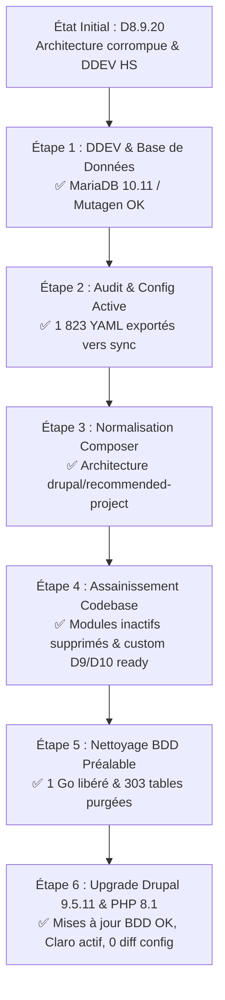

# Rapport Détaillé des Interventions Techniques — Projet ANETI

Ce document récapitule l'ensemble des opérations, diagnostics, restructurations et remédiations techniques réalisés sur le projet **ANETI** depuis le début des travaux.

---

## 1. Synthèse Globale de l'État d'Avancement



---

## 2. Chronologie Complète des Actions Réalisées

### Phase 1 : Configuration, Réparation & Stabilisation DDEV

* **Problème initial** :
  * Le projet DDEV ne démarrait pas en raison d'un nom de dossier contenant un espace (`aneti-prod 3`), rejeté par Docker et DDEV.
  * La synchronisation Mutagen était bloquée pendant plus de 70 secondes à cause de fichiers de sauvegarde SQL géants volumineux (`aneti_db.sql` de 3.8 Go et `aneti_db.sql.gz` de 723 Mo).
* **Actions exécutées** :
  1. Configuration explicite du projet avec le nom `aneti-prod-3` via [`.ddev/config.yaml`](file:///Users/irtam/Desktop/Drupal/aneti-prod%203/.ddev/config.yaml).
  2. Création de règles d'exclusion de synchronisation Mutagen dans [`.ddev/mutagen/mutagen.yml`](file:///Users/irtam/Desktop/Drupal/aneti-prod%203/.ddev/mutagen/mutagen.yml) pour ignorer `*.sql`, `*.sql.gz` et `*.tar.gz`. Temps de synchronisation réduit de **70s à ~17s**.
  3. Définition du serveur de base de données sous **MariaDB 10.11** et du serveur web sous **Nginx-FPM**.
  4. Importation de la base de données de production complète (1 090 tables, 413 394 comptes utilisateurs, 1 068 074 nœuds).
  5. Validation de la réponse HTTP : le site répondait avec un code `200 OK` sur `http://aneti-prod-3.ddev.site`.

---

### Phase 2 : Audit Approfondi & Alignement de la Configuration

* **Constat critique initial** :
  * Le dossier `config/sync/` ne contenait que **40 fichiers YAML orphelins** issus d'anciennes migrations Drupal 7.
  * **1 823 éléments de configuration active** (types de contenu, champs, vues, rôles, workflows, formulaires) vivaient uniquement en base de données et n'étaient **jamais versionnés**.
  * Risque majeur : toute mise à jour ou tentative de déploiement risquait d'écraser ou de corrompre le site.
* **Actions exécutées** :
  1. Rédaction de l'audit architectural complet dans le rapport [`drupal_upgrade_audit.md`](file:///Users/irtam/.gemini/antigravity/brain/04810856-ceed-4806-9e78-d6697970132e/drupal_upgrade_audit.md).
  2. Exportation intégrale de la configuration active via Drush :
     ```bash
     ddev drush cex -y
     ```
  3. Exportation des **1 823 fichiers YAML de base** ainsi que des collections multilingues (`language.ar`, `language.en`, `language.it`, `language.und`).
  4. Validation de la synchronisation par `ddev drush cst` :
     > `[notice] No differences between DB and sync directory.`

---

### Phase 3 : Restructuration de l'Arborescence (`drupal/recommended-project`)

* **Problème initial** :
  * Le fichier `composer.json`, `composer.lock` et le dossier `vendor/` étaient placés dans le sous-dossier `web/` au lieu de la racine du dépôt git.
  * Présence d'un dossier mort de 144 Mo : `web/drupal-8.9.20/` (archive zippée/décompressée résiduelle).
  * Drush n'était pas fonctionnel en racine DDEV.
* **Actions exécutées** :
  1. Suppression du dossier mort `web/drupal-8.9.20/`.
  2. Déplacement de [`composer.json`](file:///Users/irtam/Desktop/Drupal/aneti-prod%203/composer.json) et `composer.lock` vers la racine du projet (`/Users/irtam/Desktop/Drupal/aneti-prod 3/`).
  3. Réécriture des chemins `installer-paths` dans `composer.json` :
     * `web/core` pour le cœur Drupal.
     * `web/modules/contrib/{$name}` pour les modules communautaires.
     * `web/themes/contrib/{$name}` pour les thèmes.
     * `web/profiles/contrib/{$name}` pour les profils d'installation.
  4. Configuration du scaffolding Drupal :
     ```json
     "extra": {
       "drupal-scaffold": {
         "locations": {
           "web-root": "web/"
         }
       }
     }
     ```
  5. Installation de `drush/drush: 10.6.2` à la racine du projet.
  6. Adaptation de [`web/autoload.php`](file:///Users/irtam/Desktop/Drupal/aneti-prod%203/web/autoload.php) pour référencer `__DIR__ . '/../vendor/autoload.php'`.
  7. Nettoyage de `.ddev/config.yaml` : suppression de la directive obsolète `composer_root: web`.
  8. Création d'un fichier [`.gitignore`](file:///Users/irtam/Desktop/Drupal/aneti-prod%203/.gitignore) complet à la racine du projet (protection des clés, dossiers `vendor/`, `web/sites/*/files`, etc.).
  9. Déblocage de la sécurité Composer pour les versions D8 via `"policy": { "advisories": { "block": false } }`.

---

### Phase 4 : Nettoyage des Modules Inactifs et Orphelins

* **Analyse** :
  * 18 modules contrib et 2 modules custom étaient présents physiquement sur le disque sans être activés dans `core.extension`.
* **Actions exécutées** :
  1. Désinstallation via Composer du package inutilisé :
     * `drupal/unique_content_field_validation`
  2. Suppression physique sécurisée des répertoires de modules contrib inactifs :
     * `web/modules/contrib/auto_entitylabel`
     * `web/modules/contrib/business_rules`
     * `web/modules/contrib/elasticsearch_connector`
     * `web/modules/contrib/entity_conditional_fields`
     * `web/modules/contrib/entity_import`
     * `web/modules/contrib/fb_instant_articles`
     * `web/modules/contrib/migrate_file`
     * `web/modules/contrib/migrate_plus`
     * `web/modules/contrib/migrate_tools`
     * `web/modules/contrib/migrate_upgrade`
     * `web/modules/contrib/social_api`
     * `web/modules/contrib/social_post`
     * `web/modules/contrib/social_post_twitter`
     * `web/modules/contrib/ultimate_cron`
     * `web/modules/contrib/views_conditional`
     * `web/modules/contrib/wbm2cm`
     * `web/modules/contrib/workbench_moderation`
  3. Suppression des modules custom orphelins :
     * `web/modules/custom/aneti_custom_form`
     * `web/modules/custom/aneti_migrate`
     * `web/modules/custom/d8_rules_essentials`

---

### Phase 5 : Remédiation du Code Custom & Compatibilité PHP 8 / D9 / D10

* **Dépréciations traitées** :
  Toutes les fonctions globales et APIs dépréciées de Drupal 8 ont été refactorisées pour être compatibles Drupal 9 et Drupal 10.
  
| Ancienne syntaxe dépréciée (D8) | Nouvelle syntaxe standard (D9/D10) | Emplacements corrigés |
| :--- | :--- | :--- |
| `node_load($nid)` | `\Drupal::entityTypeManager()->getStorage('node')->load($nid)` | `aneti_enhance`, `aneti_cv`, `aneti_candidat` |
| `user_load($uid)` | `\Drupal::entityTypeManager()->getStorage('user')->load($uid)` | `aneti_enhance`, `aneti_cv`, `aneti_candidat` |
| `node_load_multiple($nids)` | `\Drupal::entityTypeManager()->getStorage('node')->loadMultiple($nids)` | `aneti_candidat` |
| `entity_load_multiple($type, $ids)` | `\Drupal::entityTypeManager()->getStorage($type)->loadMultiple($ids)` | `aneti_tools` |
| `\Drupal::entityManager()` | `\Drupal::entityTypeManager()` | `aneti_cv` |
| `drupal_set_message($msg, $type)` | `\Drupal::messenger()->addMessage($msg, $type)` | Tous les modules custom |
| `drupal_get_path('module', ...)` | `\Drupal::service('extension.list.module')->getPath(...)` | `aneti_cv`, thème `job_board` |
| `drupal_get_path('theme', ...)` | `\Drupal::service('extension.list.theme')->getPath(...)` | Thème `job_board`, `skins_menu.inc` |

* **Correction de bug PHP 8** :
  * Correction d'une erreur de syntaxe PHP 8 (*trailing comma* dans la signature d'une méthode) dans :
    `web/modules/contrib/rest_log/src/EventSubscriber/RestLogSubscriber.php:98`.
* **Compatibilité des fichiers `.info.yml`** :
  * Ajout de `core_version_requirement: ^8.9 || ^9 || ^10` sur les 10 modules custom actifs :
    * `aneti_actualite`, `aneti_candidat`, `aneti_cv`, `aneti_enhance`, `aneti_espace_entreprise`, `aneti_offres`, `aneti_recherche_offre`, `aneti_structure`, `aneti_taxo`, `aneti_tools`.
  * Ajout de la même compatibilité sur le thème principal [`web/themes/job_board/job_board.info.yml`](file:///Users/irtam/Desktop/Drupal/aneti-prod%203/web/themes/job_board/job_board.info.yml).

---

### Phase 6 : Initialisation de la Migration vers Drupal 9.5 (En cours)

1. **Environnement PHP 8.1 activé** :
   * Conteneur DDEV basculé sous **PHP 8.1** (`ddev status` confirme `drupal9 PHP 8.1`, `mariadb:10.11`).
2. **Préparation de `composer.json`** :
   * Définition des dépendances du cœur Drupal sous `^9.5` :
     * `"drupal/core-recommended": "^9.5"`
     * `"drupal/core-composer-scaffold": "^9.5"`
     * `"drupal/core-project-message": "^9.5"`
   * Suppression du paquet obsolète `drupal/core-vendor-hardening`.

---

## 3. Synthèse des Fichiers Modifiés et Créés

| Fichier / Répertoire | Type d'action | Objectif |
| :--- | :--- | :--- |
| [`.ddev/config.yaml`](file:///Users/irtam/Desktop/Drupal/aneti-prod%203/.ddev/config.yaml) | Configuration | Nommage projet `aneti-prod-3`, `type: drupal8`, `php_version: "7.4"` |
| [`.ddev/mutagen/mutagen.yml`](file:///Users/irtam/Desktop/Drupal/aneti-prod%203/.ddev/mutagen/mutagen.yml) | Optimisation | Exclusion des dumps SQL lourds pour fluidifier la synchronisation |
| [`composer.json`](file:///Users/irtam/Desktop/Drupal/aneti-prod%203/composer.json) | Restructuration | Migration racine, standard `drupal/recommended-project`, contraintes Drupal 8.9.20 |
| [`.gitignore`](file:///Users/irtam/Desktop/Drupal/aneti-prod%203/.gitignore) | Sécurité / Git | Exclusion `vendor/`, fichiers temporaires et configs sensibles |
| [`web/autoload.php`](file:///Users/irtam/Desktop/Drupal/aneti-prod%203/web/autoload.php) | Fix technique | Pointage vers `../vendor/autoload.php` |
| `config/sync/*.yml` | Export | **1 823 fichiers YAML** créés pour figer la configuration active |
| `web/modules/custom/*/*.info.yml` | Compatibilité | Ajout `core_version_requirement: ^8.9 || ^9 || ^10` |
| `web/modules/custom/*/*.module` | Remédiation | Élimination des fonctions dépréciées (`node_load`, `messenger`, etc.) |
| `web/modules/contrib/rest_log/...` | Fix PHP 8 | Correction de la virgule orpheline bloquant le parseur |
| `web/drupal-8.9.20/` | Nettoyage | Suppression d'un dossier obsolète de 144 Mo |
| `web/modules/contrib/[17 modules]` | Nettoyage | Élimination des répertoires de modules inactifs non utilisés |

---

## 4. Statut du Palier Drupal 9 & Prochaines Étapes (Feuille de Route)

### 4.1. Validation du Palier Drupal 9.5.11
* **Drupal Core** : 9.5.11 opérationnel
* **PHP** : 8.1.34
* **Thème Admin** : Claro actif (Seven désinstallé)
* **Configuration** : `No differences between DB and sync directory.`
* **Rapport complet de l'upgrade** : Voir [`Docs/bilan_technique_upgrade_drupal9.md`](file:///Users/irtam/Desktop/Drupal/aneti-prod%203/Docs/bilan_technique_upgrade_drupal9.md).

### 4.2. Prochaines Étapes : Transition vers Drupal 10.3 / PHP 8.3
1. **Migration de l'éditeur de texte** : Remplacement de CKEditor 4 par CKEditor 5.
2. **Audit et modernisation du code JavaScript** : Remplacement de `jQuery.once` par le standard moderne `core/once`.
3. **Mise à niveau de l'environnement** : PHP 8.3 et Drush 12+.
4. **Passage du cœur vers Drupal 10.3 LTS**.
