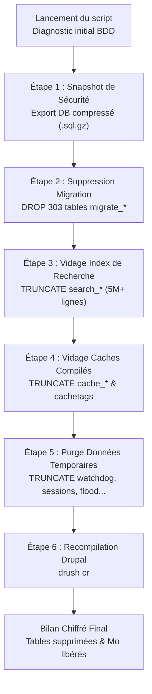

# Guide Technique & Documentation : Script d'Assainissement BDD Pré-Migration

Ce document détaille le fonctionnement, les objectifs et l'utilisation du script d'assainissement de la base de données : [`scripts/cleanup_db_pre_upgrade.sh`](../scripts/cleanup_db_pre_upgrade.sh).

---

## 1. Contexte & Justification Technique

La base de données de production du portail **ANETI** est volumineuse (plus de **1 000 000 de nœuds**, **400 000 comptes utilisateurs**, et initialement **1 091 tables** pour près de **4 Go** de données).

Avant de procéder à une migration majeure (Drupal 8 $\rightarrow$ Drupal 9 $\rightarrow$ Drupal 10/11), l'exécution des scripts de mise à jour (`drush updatedb`) et les modifications de schéma de base de données exigent un environnement sain pour éviter :
1. **Les timeouts et verrous de tables MySQL** (*table locks*) provoqués par des tables gigantesques contenant des données purement volatiles.
2. **Les conflits de schéma ou d'anciens hooks orphelins** déclenchés par des tables d'anciens modules déjà désinstallés.
3. **Des sauvegardes et synchronisations lentes** qui ralentissent les itérations de développement.

Le script [`scripts/cleanup_db_pre_upgrade.sh`](../scripts/cleanup_db_pre_upgrade.sh) a été conçu pour assainir et alléger la base de données de manière automatisée, idempotente et totalement réversible.

---

## 2. Détail des Actions Réalisées par le Script



### Étape 1 : Sauvegarde préalable (Snapshot de sécurité)
* **Action** : Exécute automatiquement `ddev export-db` vers `.ddev/backup-pre-cleanup-YYYYMMDD_HHMMSS.sql.gz`.
* **Objectif** : Garantir un point de retour immédiat en cas d'imprévu.
* **Option** : Peut être ignorée avec le flag `--skip-backup` si une sauvegarde a déjà été réalisée manuellement.

### Étape 2 : Suppression des tables orphelines de migration D6/D7
* **Action** : Détecte et supprime définitivement (`DROP TABLE`) toutes les tables préfixées par `migrate_map_*` et `migrate_message_*`.
* **Volume concerné** : **303 tables orphelines** (~28% de toutes les tables du site) pour environ **120 Mo**.
* **Justification** : Ces tables sont des résidus d'anciennes migrations Drupal 6/7 terminées depuis des années. Les modules de migration (`migrate_tools`, `migrate_upgrade`, `migrate_plus`) ayant été désinstallés du code, ces tables sont totalement mortes.

### Étape 3 : Vidage des tables de recherche volatiles
* **Action** : Tronque (`TRUNCATE TABLE`) les tables `search_index`, `search_dataset` et `search_total`.
* **Volume concerné** : **Plus de 5 millions de lignes** et **~780 Mo libérés** (la table `search_index` étant la plus grosse table de la base).
* **Justification** : L'index de recherche du cœur Drupal est purement dérivé et régénérable. Durant les montées de versions du cœur et des modules, maintenir 5 millions de lignes dans cette table ralentit drastiquement chaque opération sur les entités nœuds.
* **Régénération post-migration** : Reconstructible à tout moment via la commande Drush :
  ```bash
  ddev drush search-index
  ```

### Étape 4 : Vidage des tables de caches compilés
* **Action** : Tronque l'ensemble des tables `cache_*` (`cache_bootstrap`, `cache_config`, `cache_container`, `cache_data`, `cache_default`, `cache_discovery`, `cache_dynamic_page_cache`, `cache_entity`, `cache_menu`, `cache_page`, `cache_render`, `cache_rest`, `cache_toolbar`) ainsi que `cachetags`.
* **Volume concerné** : **~95 Mo**.
* **Justification** : Les conteneurs de services compilés sous Drupal 8 et PHP 7.4 sont obsolètes pour Drupal 9+. Conserver ces tables pleines peut provoquer des fatal errors lors du bootstrap sous une nouvelle version.

### Étape 5 : Purge des données temporaires et obsolètes
* **Action** : Tronque les tables :
  * `watchdog` : Historique des logs système accumulés en production (inutiles en environnement de dev/migration).
  * `sessions` : Plus de 5 700 sessions d'utilisateurs résiduelles du dump de production (purge hygiénique et sécuritaire).
  * `flood` : Compteurs de tentatives de connexion échouées.
  * `batch` & `semaphore` : Verrous et opérations par lots potentiellement bloqués.

### Étape 6 : Recompilation du cache Drupal
* **Action** : Exécution de `drush cr`.
* **Objectif** : Reconstituer un container de cache propre et vérifier que Drupal répond parfaitement.

---

## 3. Guide d'Exécution du Script

Le script se trouve à la racine du projet dans le dossier `scripts/`.

### 1. Mode standard (avec confirmation et sauvegarde automatique)
```bash
./scripts/cleanup_db_pre_upgrade.sh
```
Le script affiche le diagnostic, demande une confirmation utilisateur `[o/N]`, crée la sauvegarde compressée puis exécute le nettoyage.

### 2. Mode automatique (pour CI/CD ou automatisation)
```bash
./scripts/cleanup_db_pre_upgrade.sh -y
```

### 3. Mode rapide (sans créer de sauvegarde)
```bash
./scripts/cleanup_db_pre_upgrade.sh -y --skip-backup
```

### 4. Aide et options
```bash
./scripts/cleanup_db_pre_upgrade.sh --help
```

---

## 4. Procédure de Restauration (Rollback)

Si vous devez pour une raison quelconque restaurer la base à son état initial exact :

1. Repérez le fichier de sauvegarde généré dans `.ddev/` (par exemple `.ddev/backup-pre-cleanup-20261110_221000.sql.gz`).
2. Exécutez la commande d'import DDEV :
   ```bash
   ddev import-db --file=.ddev/backup-pre-cleanup-20261110_221000.sql.gz
   ```
3. Videz les caches :
   ```bash
   ddev drush cr
   ```

---

## 5. Bilan Réel Obtenu Après Exécution

| Indicateur | Avant exécution | Après exécution | Résultat Réel Obtenu |
| :--- | :--- | :--- | :--- |
| **Nombre total de tables** | 1 091 tables | 788 tables | **-303 tables orphelines supprimées** |
| **Lignes dans search_index** | 5 082 668 lignes | 0 (table vidée) | **-5 millions de lignes purgées** |
| **Poids total en base** | 9 195,95 Mo | 8 160,30 Mo | **1 035,65 Mo libérés (> 1 Go)** |
| **Sauvegarde de sécurité** | - | Générée avec succès | `.ddev/backup-pre-cleanup-20261110_220956.sql.gz` |
| **Statut Drupal** | - | Opérationnel | `HTTP 200 OK` / Cache reconstruit |

