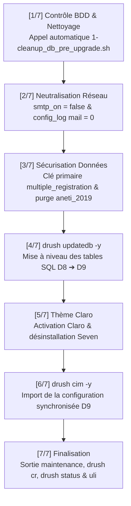

# Guide d'Utilisation : Script Automatisé d'Upgrade Drupal 9 (`drupal9-upgrade.sh`)

Ce document décrit le fonctionnement, les étapes et l'utilisation du script automatisé d'upgrade vers Drupal 9 : [`scripts/2-upgrade_drupal9.sh`](file:///Users/irtam/Desktop/Drupal/aneti-prod%203/scripts/2-upgrade_drupal9.sh) (accessible également via le raccourci [`scripts/drupal9-upgrade.sh`](file:///Users/irtam/Desktop/Drupal/aneti-prod%203/scripts/drupal9-upgrade.sh)).

---

## 1. Rôle et Objectif du Script

Ce script est conçu pour être exécuté sur n'importe quel environnement (machine de dev locale ou serveur de recette) dès lors qu'un dump de base de données Drupal 8 de production vient d'être importé sur le codebase Drupal 9.

Il orchestre l'ensemble des opérations requises en assurant :
1. **La sécurité des données** : aucune donnée métier n'est supprimée ; les 318 075 comptes candidats et inscrits sont 100 % préservés.
2. **La prévention des blocages connus** :
   * Neutralisation du produit cartésien SQL de `multiple_registration_update_8204()` (101 milliards de comparaisons évitées).
   * Désactivation des notifications SMTP externes pour éviter les blocages de timeout réseau.
   * Nettoyage des résidus orphelins liés à l'ancien thème `aneti_2019` pour permettre un `drush cim` sans friction.
3. **L'enchaînement strict dans les règles de l'art Drupal** :
   `Nettoyage préalable ➔ drush updatedb ➔ Claro ➔ drush cim ➔ drush cr`.

---

## 2. Syntaxe & Options

Le script peut être lancé depuis la machine hôte ou directement à l'intérieur du conteneur DDEV :

```bash
# Exécution interactive (demande confirmation)
./scripts/drupal9-upgrade.sh

# Exécution automatisée (idéale en CI/CD ou script de restore)
./scripts/drupal9-upgrade.sh -y
```

### Options disponibles :

| Option | Description |
| :--- | :--- |
| `-y`, `--yes` | Valide automatiquement les confirmations interactives. |
| `--skip-cleanup` | Ne lance pas automatiquement le script de nettoyage préalable [`scripts/1-cleanup_db_pre_upgrade.sh`](file:///Users/irtam/Desktop/Drupal/aneti-prod%203/scripts/1-cleanup_db_pre_upgrade.sh). |
| `-h`, `--help` | Affiche l'aide et la liste des arguments. |

---

## 3. Détail des 7 Étapes Exécutées par le Script



### Étape 1 : Vérification BDD & Nettoyage préalable
* Vérifie si des tables orphelines de migration D6/D7 (`migrate_map_*`) subsistent dans la base.
* Si oui, lance automatiquement [`scripts/1-cleanup_db_pre_upgrade.sh -y`](file:///Users/irtam/Desktop/Drupal/aneti-prod%203/scripts/1-cleanup_db_pre_upgrade.sh) pour libérer plus de **1 Go** de données volatiles (5M de lignes de recherche, caches, watchdog).

### Étape 2 : Neutralisation des timeouts SMTP
* Passe `smtp_on: false` et désactive l'envoi d'emails dans `config_log` pour éviter les ralentissements réseau sur chaque entité sauvegardée en environnement local.

### Étape 3 : Sécurisation de `multiple_registration` & nettoyage blocs et modules orphelins
* Supprime les blocs orphelins liés à l'ancien thème `aneti_2019` pour que le validateur de synchronisation Drupal ne bloque pas l'import.
* Désinstalle de manière défensive les modules inactifs et obsolètes s'ils sont encore présents (`select2`, `conditional_fields`, `unique_entity_title`, `rules_role_email`, `taxonomy_term_depth`, `taxonomy_import`, `menu_export`, `search_exclude`, `devel`, `rest_log`, `node_action_log`, `aneti_tools`, `color`, `quickedit`, `rdf`, `hal`, `tracker`).
* Applique directement la clé primaire `(uid, rid)` sur `multiple_registration` et enregistre le schéma 8204 dans le registre Drush. Les **318 075 comptes utilisateurs restent 100 % intacts** et la boucle infinie est neutralisée.

### Étape 4 : Mises à jour de schémas (`drush updatedb`)
* Passe le site en mode maintenance pour garantir l'intégrité transactionnelle.
* Exécute l'ensemble des hooks de mise à jour de schéma BDD (`drush updatedb -y`) et vide le cache.

### Étape 5 : Thème d'administration Claro
* Active le thème officiel moderne **Claro**.
* Configure Claro comme thème d'administration principal.
* Désinstalle proprement l'ancien thème déprécié **Seven**.

### Étape 6 : Import de la configuration synchronisée (`drush cim`)
* Importe les fichiers YAML versionnés du dossier `config/sync/` dans la base de données.
* Reconstruit les caches d'entités et de routage.

### Étape 7 : Sortie de maintenance & Restitution
* Désactive le mode maintenance.
* Exécute un `drush cr` final.
* Affiche l'état de santé du site (`drush status`) avec confirmation du bootstrap.
* Génère et affiche un lien de connexion administrateur one-time (`drush uli`).

